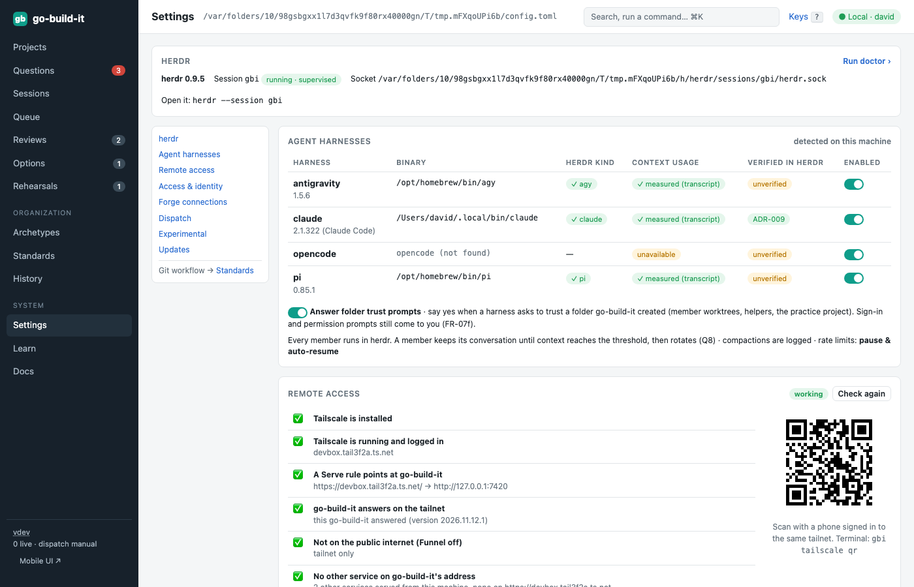
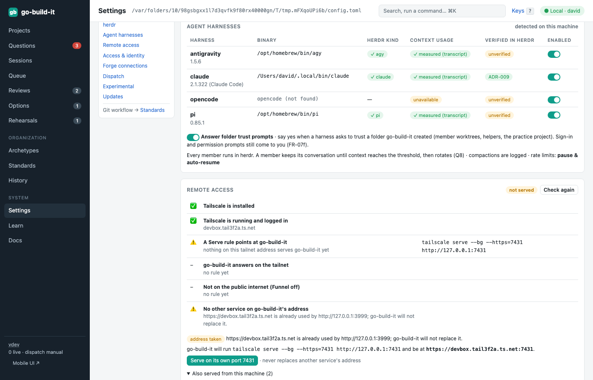

section: Getting started
reqs: FR-15, FR-16, FR-17, FR-18, FR-19, FR-20, FR-20a, FR-20b, FR-20c, FR-20d
# Access, identity and Tailscale

go-build-it listens on `127.0.0.1:7420` only. Who you are depends on how you reach it:

| How you connect | Challenge | Identity in history |
|---|---|---|
| This machine (loopback) | none | the default user (`default_user` in config) |
| Tailscale Serve | none: Tailscale already authenticated you | your Tailscale login, e.g. `maria@github` |
| Any other network interface | refused (ADR-005) | — |

## Remote access

**Settings → Remote access** (or `gbi tailscale status`) checks that go-build-it really works on your tailnet. Each line shows what it found, and the fix when it fails:

1. **Tailscale is installed.**
2. **Tailscale is running and logged in**, with this machine's tailnet name.
3. **A Serve rule points at go-build-it.** The rule must send its root address to go-build-it's own port.
4. **go-build-it answers on the tailnet.** go-build-it calls its own tailnet URL and checks that the answer comes from *this* go-build-it, not another program or a second copy.
5. **Not on the public internet.** Funnel must be off. go-build-it trusts Tailscale's identity, so it must stay on your tailnet.
6. **No other service on go-build-it's address.**

Under the checklist, **Also served from this machine** lists every other address Tailscale serves from this computer, with the program behind it.

**Set it up:** press **Serve on my tailnet**, or run `gbi tailscale setup`. go-build-it then answers at `https://<machine>.<tailnet>.ts.net`, and the badge in the top bar shows *Tailnet · you@login*.

**When another app already uses that address,** go-build-it never replaces it. It names the app, proposes a port of its own (for example `https://<machine>.<tailnet>.ts.net:7420`), and shows the exact `tailscale serve` command. It runs the command only when you press **Serve on its own port**, or with `gbi tailscale setup --confirm`.

**Stop serving** (`gbi tailscale stop`) removes go-build-it's own rule and nothing else. Only owners can set up or stop serving, and each change is recorded in the history.

**On your phone:** once every check passes, Remote access shows a QR code of the address. Scan it with a phone that is signed in to the same tailnet. In a terminal, `gbi tailscale qr` draws the same code.

`gbi doctor` checks this too (`tailscale.serve`). It skips the check if you don't use Tailscale.

**Owners and reviewers (ADR-006):** anyone who reaches the app can answer questions, add rehearsal findings and review work. Only owners approve gates and start releases. Add owners with `owners = ["david", "maria@github"]` in `config.toml`.

**External access** stays off. If you turn on `allow_external`, you must also set `external_token`; external requests then need `Authorization: Bearer <token>`.
