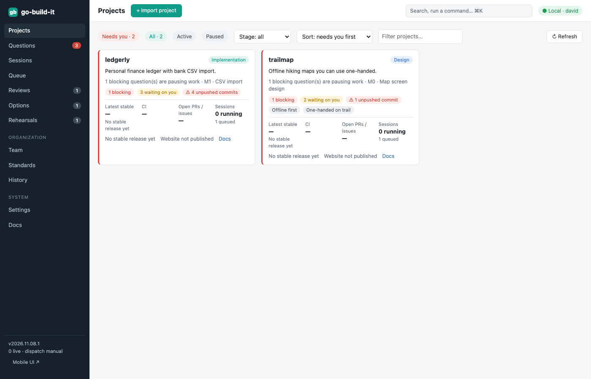
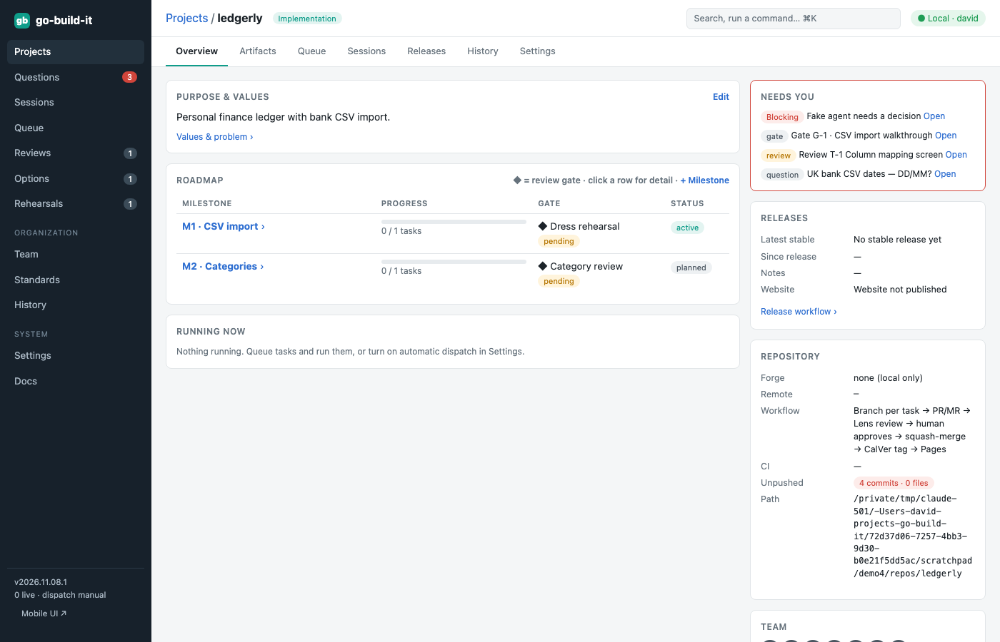
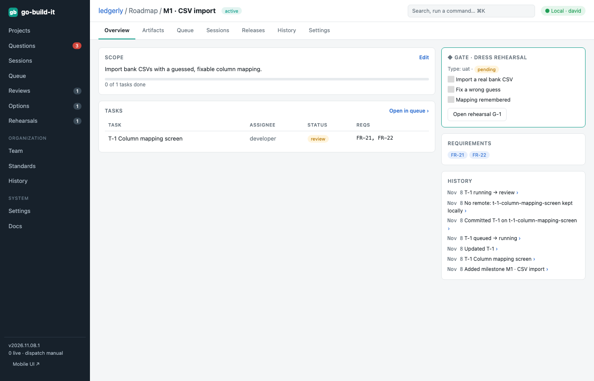

section: Using go-build-it
reqs: FR-40, FR-41, FR-41a, FR-42, FR-43, FR-44, FR-45b, FR-94, FR-115
# Projects, roadmap and review gates

The landing page is the **catalog**: one card per project. Projects that need you come first and have a red edge. A project needs you when it has a question, review, gate or option set waiting, unpushed work, or failing CI.

Each card shows:
- what the project is and its stage
- a status sentence and the current milestone
- the latest stable release, with commits since
- CI status, and open PRs and issues
- links to the release notes, the website and the repository

Placeholders such as *No stable release yet* appear instead of gaps.

**Import a project:** *+ Import project* (or `gbi projects import --path …`). go-build-it detects GitHub or GitLab from the remote.

The **project overview** shows purpose and values, the roadmap with review gates (◆), what's running, and releases.

Click a milestone to open the **roadmap item** page: its scope, tasks, linked requirements, gate criteria and history. While a milestone's gate is unapproved, tasks in later milestones wait. The queue shows them as *waits for gate …*.

