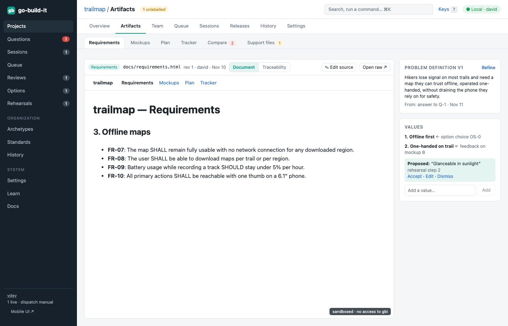
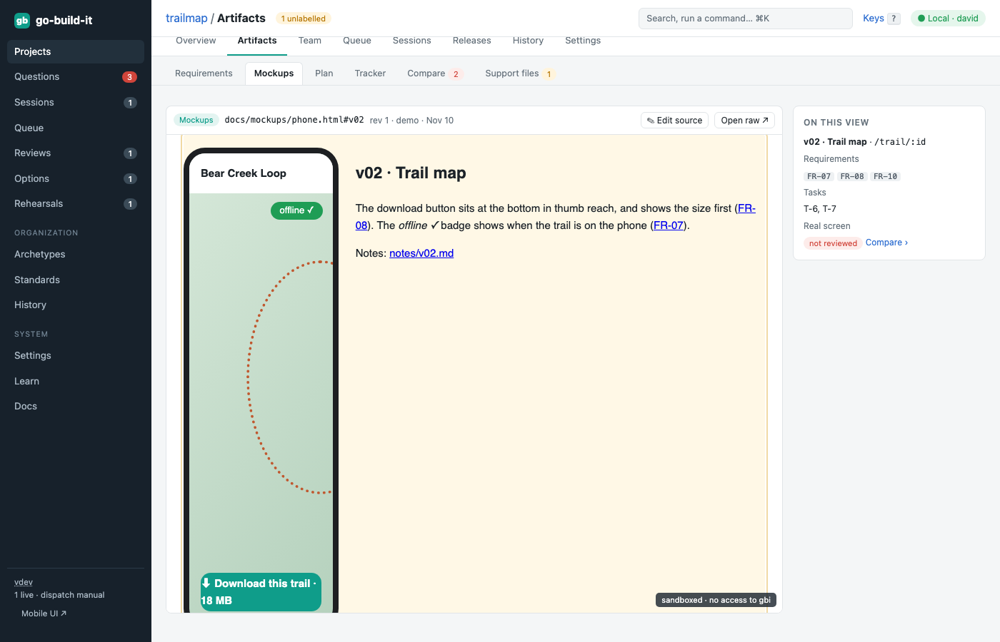
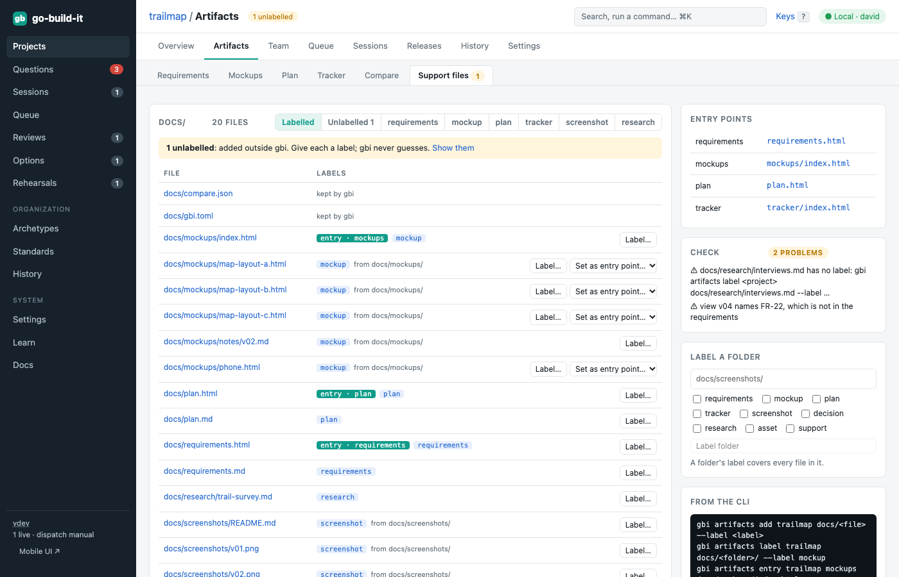
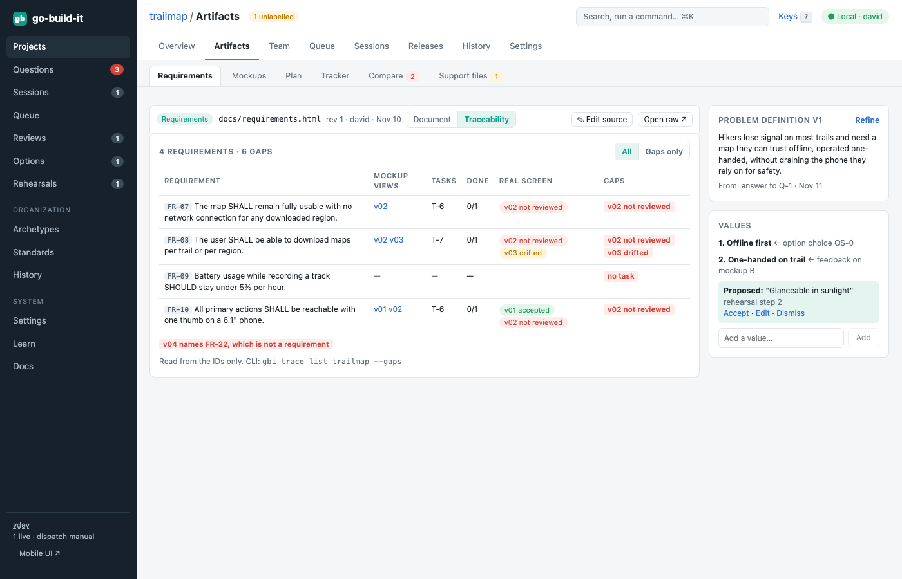
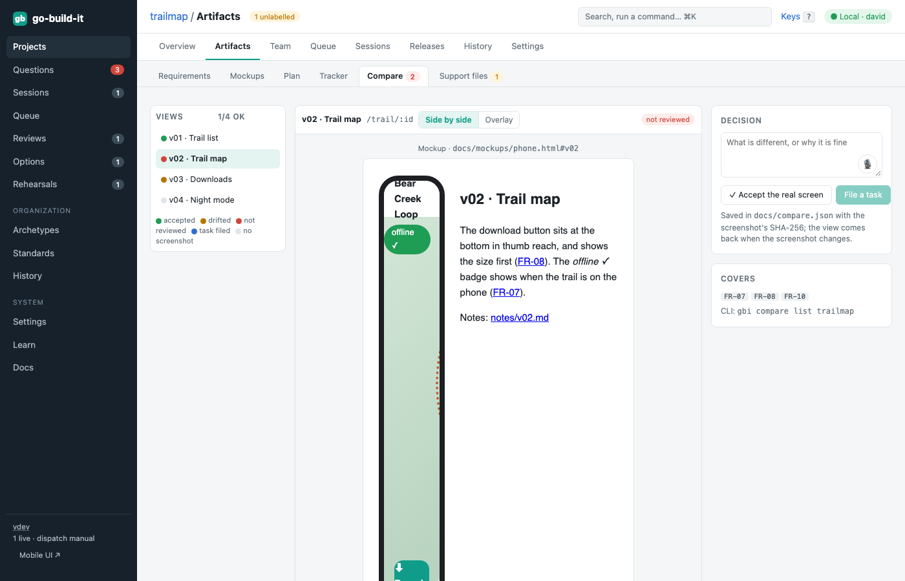
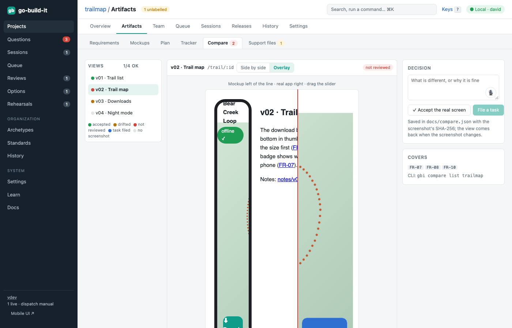
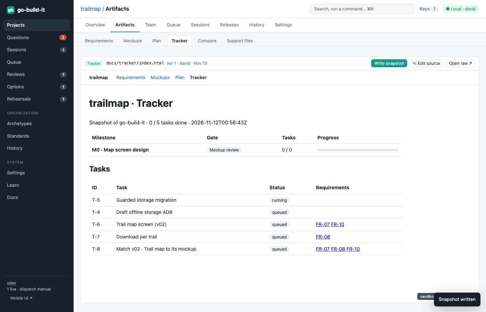
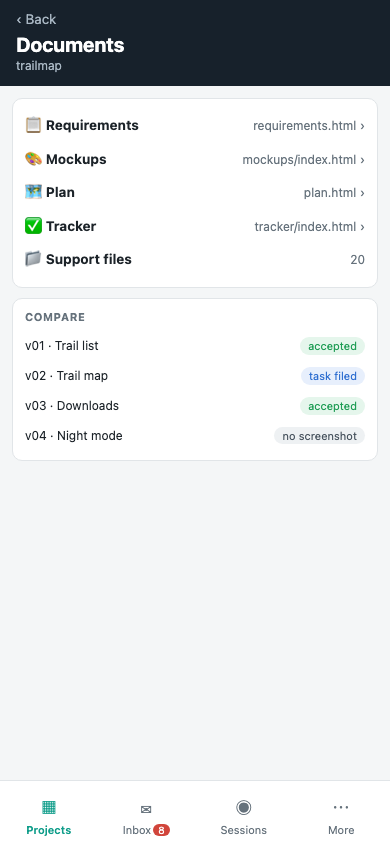
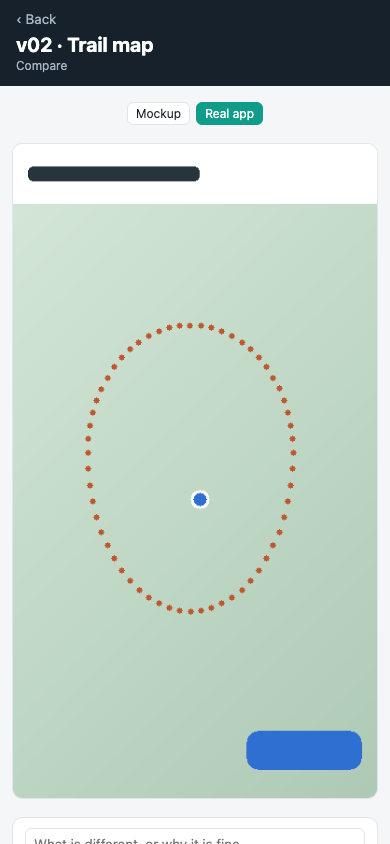
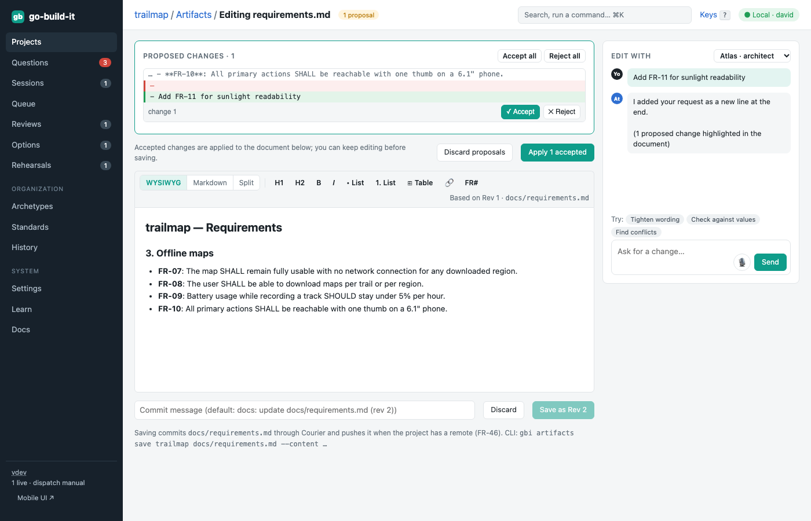

section: Using go-build-it
reqs: FR-45, FR-45a, FR-46, FR-123, FR-151, FR-140, FR-141, FR-142, FR-143, FR-144, FR-145, FR-146, FR-147, FR-148, FR-149, FR-150
# Project documents

Every project keeps the same documents in its repository under `docs/`: requirements, mockups, a plan and a tracker. go-build-it shows them on the project's **Artifacts** tab, which has six sub-tabs:

| Sub-tab | What it shows |
|---|---|
| **Requirements** | the requirements entry point, and a **Traceability** view |
| **Mockups** | the mockups entry point, which links to each set of mockups |
| **Plan** | the plan entry point |
| **Tracker** | the tracker entry point, which reads a snapshot of go-build-it's milestones and tasks |
| **Compare** | each mockup view next to a screenshot of the real app |
| **Support files** | every file under `docs/`, with its labels |

The rules are in the global standard **Project documents** (Standards), which AI members follow too.

## Choosing your tabs

`docs/gbi.toml` decides which sub-tabs a project has, in what order, and what they're called:

```toml
[entries]                       # each role gets a tab, in this order
vision       = "docs/vision.html"
requirements = "docs/requirements.html"
plan         = "docs/plan.html"

[titles]                        # optional names
vision = "Product vision"
```

- **Your own roles:** any short lowercase name works, such as `vision`, `research` or `roadmap`.
- **Leave out what you don't use:** with no `mockups` entry there is no Mockups tab and no Compare tab. Support files is always there.
- **A fixed list:** for full control, add `tabs = ["vision", "requirements", "plan", "compare", "files"]` at the top. Only those tabs show, in that order. `compare` and `files` are the built-in tabs.
- **gbi keeps your layout:** your order, `tabs` and `[titles]` survive when gbi updates the file.
- **From the CLI:** `gbi artifacts entry <project> vision docs/vision.html` adds a role.

After a hand edit, reload the page (gbi reads the file on every request), commit the file yourself, and run `gbi artifacts check <project>`.

## Entry points are HTML

Requirements, Mockups, Plan and Tracker each open one **entry point**: an HTML file you chose. go-build-it never picks one for you. Choose one with **Set as entry point** in Support files, or:

```
gbi artifacts entry trailmap mockups docs/mockups/index.html
```



**Pages are sandboxed.** They run their own scripts, and load their own images, Markdown and JSON from the repository by relative path. They can't use go-build-it's API.

**Links are how you move around.** The viewer follows them:
- a link to another entry point switches tab
- a Markdown file opens rendered
- the `#anchor` is kept, and the address bar shows exactly where you are, so you can copy it to share

If you have several sets of mockups (for example web and phone), link to them from the mockups entry point.



**Write prose in Markdown.** The requirements and plan entry points include their Markdown with `<gbi-md src="requirements.md">`. **Edit source** opens that Markdown in the editor. Each `**FR-07**:` line becomes an anchor, so `requirements.html#FR-07` jumps to it.

The right rail keeps the living **problem definition** and the project's **values**. Values are proposed from your answers, choices and feedback; accept, edit or dismiss them.

## Labels: nothing is guessed

Every file under `docs/` has one or more labels from a fixed list: `requirements`, `mockup`, `plan`, `tracker`, `screenshot`, `decision`, `research`, `asset`, `support`. A label on a folder covers the files in it. Labels are added explicitly, mostly with the CLI:

```
gbi artifacts add trailmap docs/research/survey.md --label research   # a label is required
gbi artifacts label trailmap docs/screenshots/ --label screenshot      # a folder
gbi artifacts files trailmap --label mockup                            # list
```

A file that arrives another way, for example from `git pull`, is listed as **Unlabelled** until someone labels it.

Entry points and labels are stored in `docs/gbi.toml`. Courier commits every change, so a clone of the repository carries its structure with it.



Check what needs attention:

```
$ gbi artifacts check trailmap
```

It lists:
- missing entry points
- unlabelled files
- labels on files that no longer exist
- broken links in labelled HTML
- views that name a requirement that doesn't exist

## IDs connect everything

| Thing | ID | Where |
|---|---|---|
| Requirement | `FR-07`, `NFR-01` | `**FR-07**:` at the start of a line in the requirements |
| Mockup view | `v02` | `data-view="v02"` on an element, with `data-req="FR-07 FR-08"` and `data-route="/trail/:id"` |
| Task | `T-12` | lists its requirements in `reqs`, and may name views in its text |
| Screenshot | `v02.png` | labelled `screenshot`, named after the view |

**Traceability** on the Requirements tab follows these IDs and nothing else. Each requirement gets a row with its views, tasks and real screens. The **gaps** are a requirement with no task, a view whose screen drifted or was never reviewed, and a view that names an unknown requirement. A requirement without a view isn't a gap, because not everything is visual.

```
$ gbi trace list trailmap --gaps
```



## Compare mockups with the real app

**Compare** puts each mockup view next to the screenshot with the same name, which is usually written by your UI tests. Show them **side by side**, or as an **overlay** and drag the line across.



Comparing a mockup with real data pixel by pixel finds mostly noise, so this is your call:
- **Accept the real screen**, optionally with a note, or
- **File a task** saying what to change. The task cites the view's requirements and links back here.



Decisions are saved in `docs/compare.json` with the screenshot's SHA-256. A view comes back as **drifted** when its screenshot changes. The states are: no screenshot, not reviewed, accepted, drifted, task filed.

```
$ gbi compare list trailmap
gbi compare accept trailmap v01 --note "Matches"
gbi compare task trailmap v02 --note "The offline badge is missing"
```

## The tracker is a snapshot

go-build-it's milestones and tasks are the source of truth. **Write snapshot** on the Tracker tab, or `gbi artifacts snapshot trailmap`, has Courier commit `docs/tracker/tracker.json`. The tracker HTML reads that file, so the copy in the repository matches the app.



## Starting a project's documents

A tab without an entry point offers **Create the standard set**, which is the same as:

```
gbi artifacts init trailmap
```

It writes the templates (requirements, mockups, plan, tracker, a screenshots folder) and `docs/gbi.toml`, and sets the entry points and labels. It never overwrites a file that exists.

## On your phone

**Documents** on a project lists the entry points, which open full screen, and the Compare states. Compare works there too: switch between the mockup and the real app, then accept or file a task with a dictated note.





## Editing

**Edit source** opens the artifact editor. Ask a persona for a change in the chat panel, and its proposal appears as highlighted changes that you accept or reject one by one. Or edit directly in WYSIWYG, Markdown or split mode. **Save** commits the file through Courier as a new revision, and pushes it when the project has a remote.


