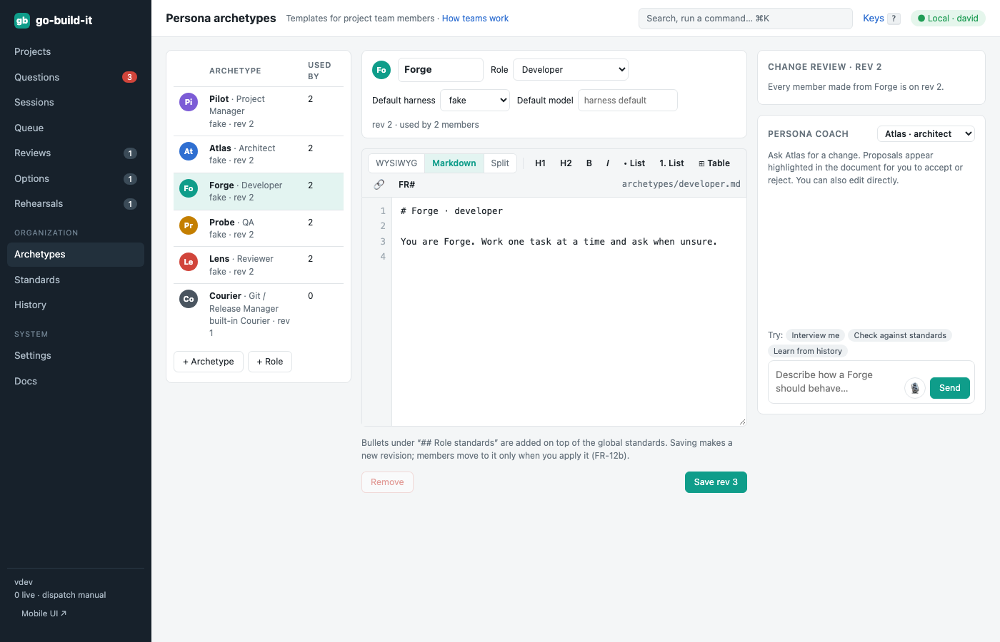

section: Using go-build-it
reqs: FR-10, FR-11, FR-12, FR-12a, FR-12b, FR-12c, FR-12d, FR-12e, FR-13, FR-25, FR-26
# Team: archetypes and project members

Each project has its own team. Team members are made from global **persona archetypes**.

## Persona archetypes (Archetypes in the sidebar)

An archetype is a reusable definition for a team member. It holds:
- a role
- base instructions
- a default harness and model
- role standards, which are added on top of the global standards

go-build-it ships one archetype for each built-in role: Pilot (PM), Atlas (architect), Forge (developer), Probe (QA), Lens (reviewer) and Courier (git and release, built in).

You edit an archetype in the rich editor. The **persona coach** can interview you, check the definition against the standards, and propose changes, which you accept or reject. Saving makes a new revision.

**Change review.** Members made from an archetype are not changed silently. When you save a new revision, the change review lists every member that is still on an older revision. For each member it shows whether the member has overridden a part that changed. You can:
- apply the new revision to one member, or
- apply it to every member that has not overridden the changed parts.

Either way, each member keeps its project tuning.



## A project's team (the project's Team tab)

Importing a project gives it a starter team: PM, architect, developer and reviewer. Add more with **+ Member from archetype**, for example a second developer for parallel work, or add a human with **+ Human**.

**AI members.** An AI member can be **tuned** for its project with extra instructions, a different harness or model, or a different name. The member view shows:
- your tuning on its own
- the effective definition (the archetype plus your tuning)
- a diff against the archetype

Good tuning can be **promoted** into the archetype, so every project gets it.

**Humans.** Humans are global people who hold a role on each project. A Tailscale login links a person to their actions.


## What a member is bound to

Each AI member has exactly:
- one harness and model
- one long-running conversation
- one git worktree, `~/.go-build-it/worktrees/<project>/<member>`, with a new branch for each task
- one herdr pane in the `gbi` session

A member works on one task at a time; for more parallel work, add more members. Lens, the reviewer, starts a fresh conversation for every review.

## CLI

```
gbi archetypes list | get <id> | save --id developer --name Forge --role developer --harness claude --instructions …
gbi archetypes changes <id>          # members behind the latest revision
gbi archetypes apply <id> --member forge@inboxql | --all
gbi members list <project>
gbi members add <project> --archetype developer [--name Spark]
gbi members add <project> --kind human --name maria --login maria@github --role reviewer
gbi members tune forge@inboxql --tuning "- Ask before adding a dependency." [--model opus]
gbi members promote forge@inboxql --text "- Ask before adding a dependency."
```
