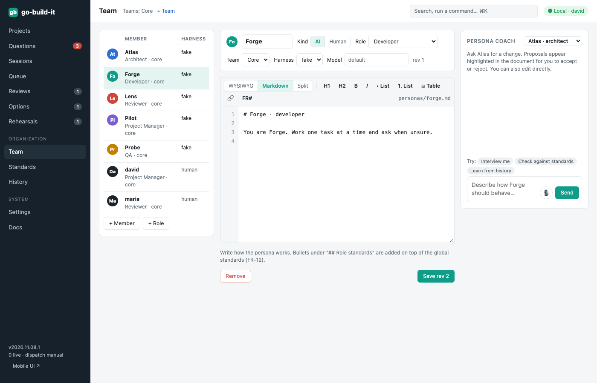

section: Using go-build-it
reqs: FR-10, FR-11, FR-12, FR-13, FR-25, FR-26
# Team and personas

A team member is an **AI persona** or a **human**, holding a role: Project Manager, Architect, Developer, QA, Reviewer or Git / Release Manager, or a custom role.

Each AI persona has:
- a harness (Claude Code, OpenCode, Antigravity or Pi) and a model
- a definition written in Markdown

Bullets under `## Role standards` in the definition are added on top of the global standards.

The **persona coach** (right column) is an agent that helps you develop a persona. It interviews you, checks against the standards, and suggests changes from history.

