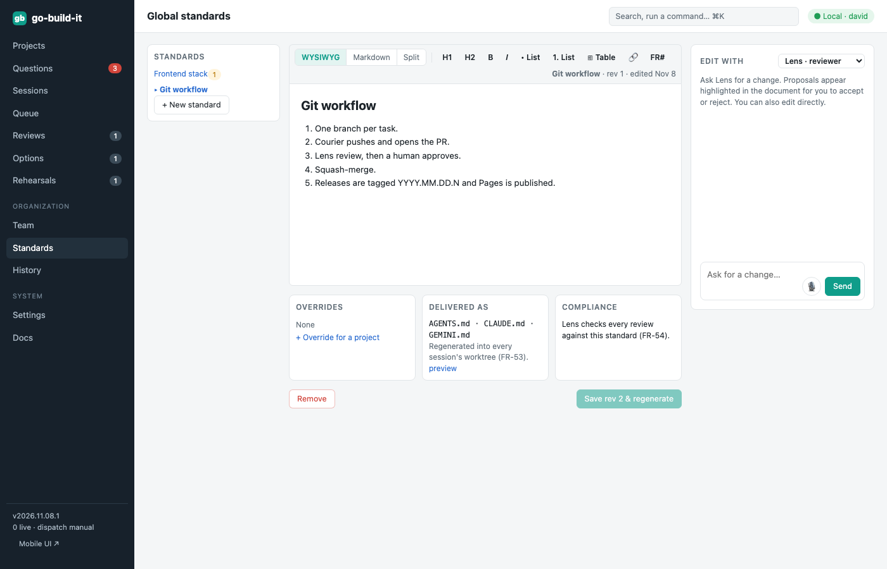

section: Using go-build-it
reqs: FR-50, FR-51, FR-52, FR-53, FR-54, FR-91
# Global standards

Standards apply to every project:
- backend stack
- frontend stack
- testing
- documentation
- versioning
- **git workflow**, which Courier follows (FR-91)

Edit them in the editor, or ask a persona in the chat panel. A project can override a standard, and every override needs a reason.

Standards reach agents automatically. Each session's worktree gets generated `AGENTS.md`, `CLAUDE.md` and `GEMINI.md` files, which are removed again before Courier commits. Lens checks every review against them.

