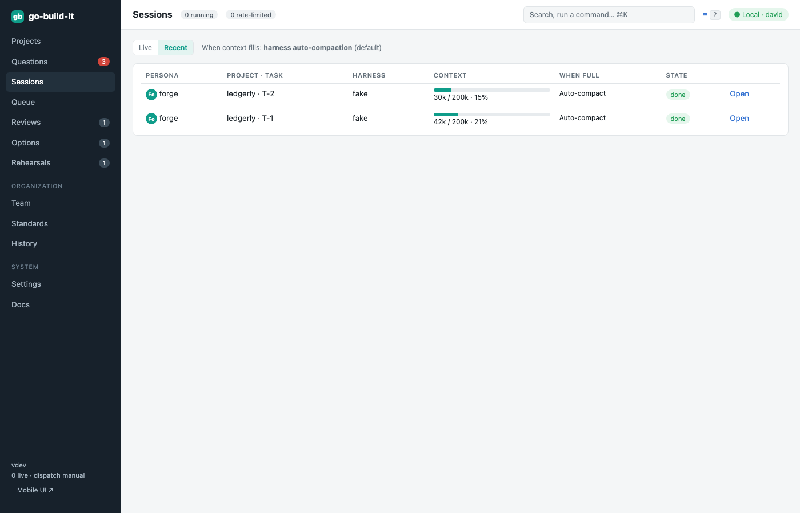
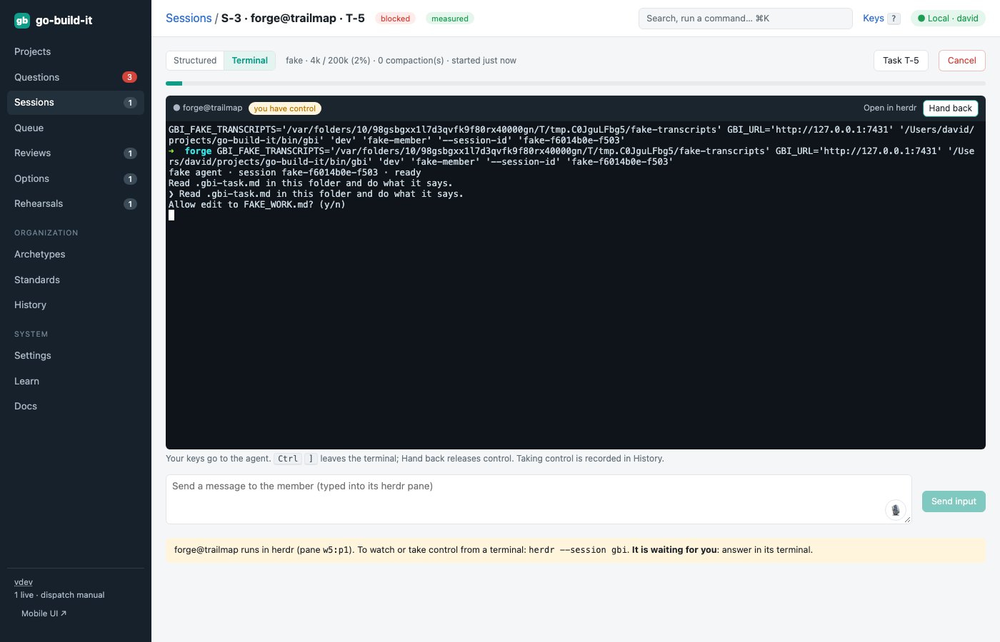

section: Using go-build-it
reqs: FR-60, FR-61, FR-62, FR-64, FR-65, FR-66, FR-67, FR-68, FR-69, FR-70, FR-71, FR-72, FR-73, FR-74, FR-76
# Team members at work: sessions, terminals and conversations

Every AI team member runs as a long-running harness (Claude Code, Antigravity, Pi or OpenCode) in its own pane of the `gbi` herdr session. It works in its own git worktree, `~/.go-build-it/worktrees/<project>/members/<name>`, and each task gets a fresh branch there.

A **session** is one member working on one task. go-build-it writes the task to `.gbi-task.md` in the member's worktree and asks the member to read it. The task brief contains:
- the task itself
- the requirements in scope
- the project's values and problem definition
- notes from earlier work, answers and review feedback

It does not contain the whole project history.

## Status comes from herdr

herdr reports each member as working, blocked, done or idle.

**Blocked members.** A **blocked** member is waiting for you, for example at a sign-in screen or a permission dialog. It appears:
- at the top of the Sessions page
- in the Questions dashboard
- in the mobile Inbox

Open the live terminal and answer it there, or answer in herdr itself.

**Folder trust is answered for you.** The first time a harness runs in a folder, it asks whether to trust it. Member worktrees and helpers live in go-build-it's own folder (`~/.go-build-it`), so go-build-it answers *Yes, I trust this folder* and the member starts without you. Each answer is in the history as *agent.trusted*.
- **Turn it off:** **Settings → Agent harnesses → Answer folder trust prompts**. The prompt then shows up as a blocked member.
- **What it never answers:** sign-in screens, permission dialogs, or anything in a folder outside `~/.go-build-it`.

**Fewer prompts.** Members run in accept-edits mode, which removes most prompts.

## Live terminal

Open a session and choose **Terminal** to watch the member's pane live. Several people can watch at once, and watching never resizes the pane.
- **Take control** sends your keys, paste and window size to the agent.
- **Hand back** releases control.
- <kbd>Ctrl</kbd> <kbd>]</kbd> leaves the terminal.

Taking control and handing back are recorded in History. On a phone, the terminal has a key bar for Esc, Tab, Ctrl-C, the arrows and Enter.

**Open in herdr** focuses the member's pane and copies `herdr --session gbi`, so the same pane is open when you attach from a terminal. There, each project is a workspace, and each member's worktree is grouped under it. Each pane is labelled with the member's name and role, its current task, its context use and how many tasks are in its conversation.

The **Structured** view lists what the member did, read from its transcript: your prompt, the files it read and edited, the commands it ran and its messages.

## Context and conversations

Context usage is read from the harness's transcript:
- **Measured:** Claude Code, Antigravity and Pi.
- **Unavailable:** OpenCode, which keeps its sessions in a database.

A member keeps **one conversation across tasks** until its context reaches the threshold (75% by default). It then **rotates**: the next task starts a new conversation from the task brief plus the member's notes from earlier tasks (Q8). Lens, the reviewer, starts a fresh conversation for every review.

You can restart a member from its Team page. **Restart** resumes the same conversation; **New conversation** starts afresh.

**Compaction.** If the harness compacts on its own, the compaction is logged in History.

**Smart handoffs** are experimental (Settings → Experimental). At the threshold, the member writes a briefing with:
- the objective and definition of done
- the current state
- decisions made and why
- dead ends to avoid
- next steps
- pointers to files and artifacts

The task then continues in a new conversation that starts from that briefing (ADR-007).

**Rate limits.** When a subscription limit is hit, the task pauses, and it resumes automatically when the limit resets.

## Restarts

herdr owns the harness processes, so restarting or updating go-build-it does not stop your members. When go-build-it comes back, it reattaches to members that are still working. If herdr itself restarts, it restores each pane and resumes its conversation, and go-build-it finds the members again.
