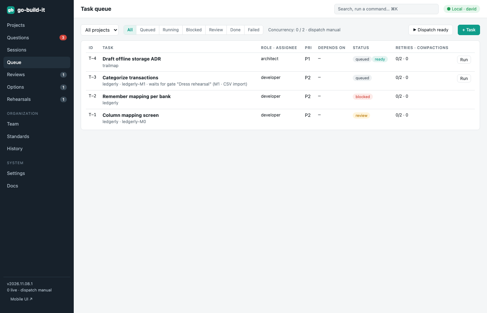

section: Using go-build-it
reqs: FR-75, FR-80, FR-81, FR-82
# Task queue and dispatch

Each project has a persistent queue. Tasks have a priority, dependencies, a role and an optional assignee, and are retried on failure. Ready tasks start automatically when *Automatic dispatch* is on (Settings), up to the concurrency limit, or when you press **Run**. After a restart, interrupted tasks are requeued.

Tasks that keep running out of context are flagged for splitting.

