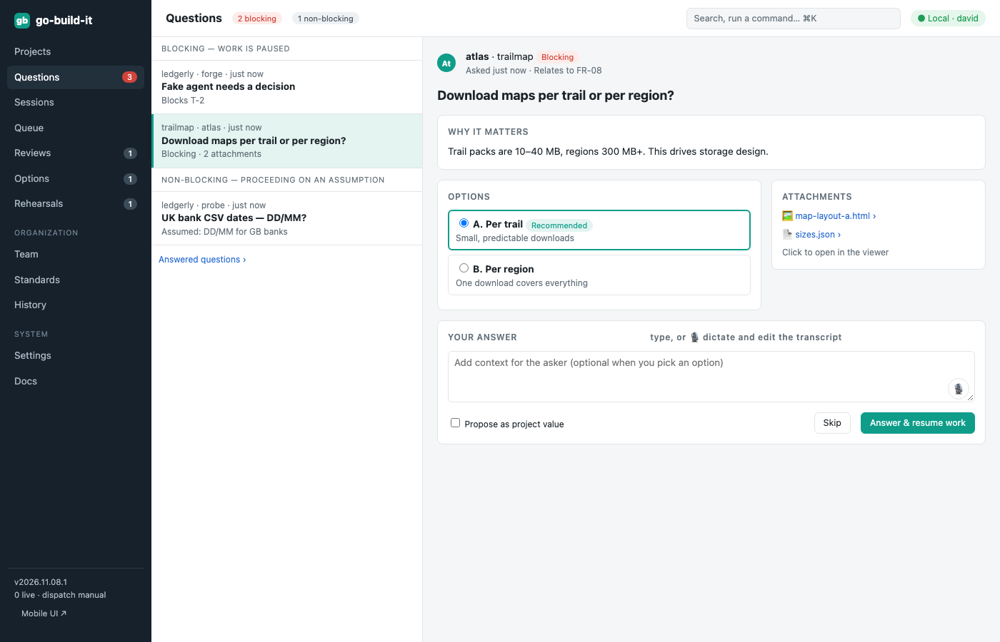
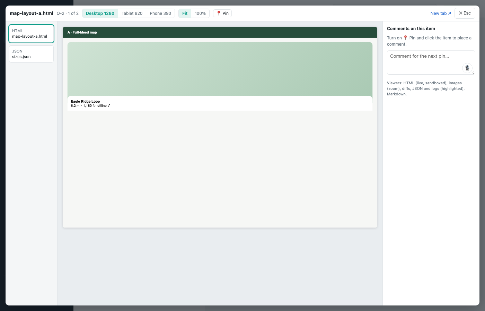

section: Using go-build-it
reqs: FR-100, FR-101, FR-102, FR-102a, FR-103, FR-104, FR-105, FR-107
# Questions

Agents ask with `gbi questions ask`.
- A **blocking** question pauses the task.
- A **non-blocking** one states the assumption work continues on.

The dashboard lists blocking questions first. Each question shows why it matters, the asker's recommendation, structured options and attachments.

Attachments open in the **viewer**:
- HTML mockups run live and sandboxed, at desktop, tablet or phone size
- images, diffs, JSON and logs each have a suitable view
- you can pin comments onto the item

Answer by typing or with 🎙 dictation. The answer goes back to the task's notes and the task resumes.
