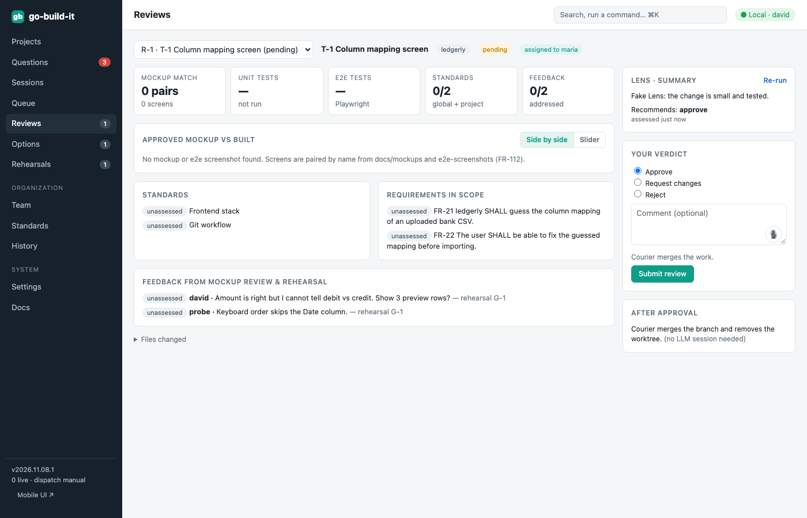

section: Using go-build-it
reqs: FR-54, FR-92, FR-110, FR-111, FR-112
# Work review

When a session finishes, Courier commits, pushes and opens a PR, and Lens opens a review. A review is an assessment, not a diff:
- the approved mockup next to what was built (e2e screenshots, side by side or with a slider)
- unit and e2e test results
- standards
- rehearsal feedback
- requirements, each marked met, partly met or not met, with evidence

**Your verdict:**
- **Approve:** Courier merges the work.
- **Request changes:** your comment goes into the task's notes and the task is requeued.
- **Reject:** the task is closed.
