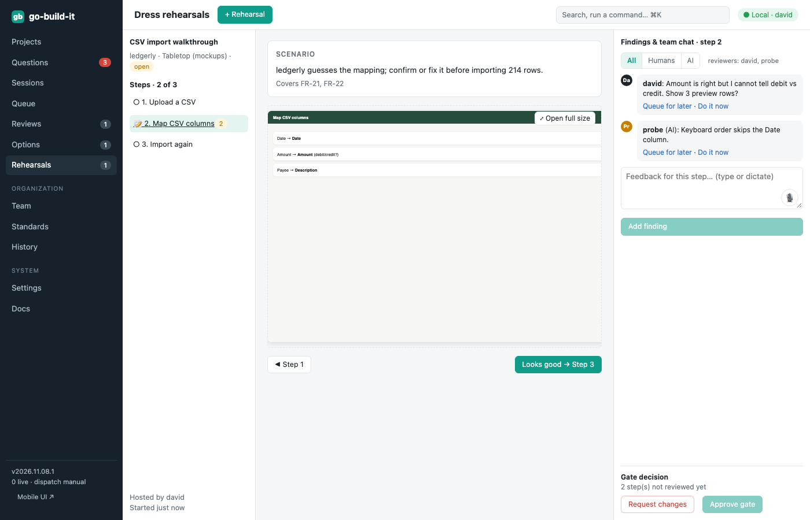
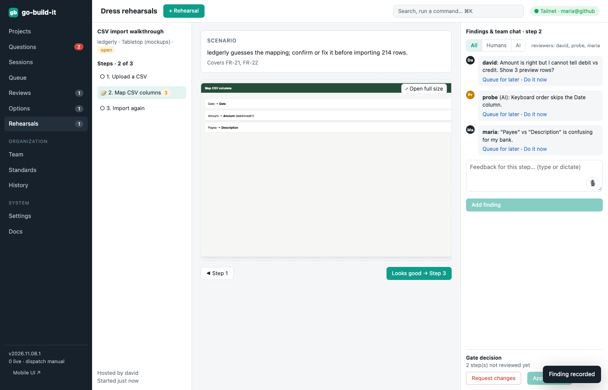

section: Using go-build-it
reqs: FR-115, FR-116, FR-116a, FR-117, FR-117a, FR-118
# Dress rehearsals and gates

A rehearsal walks through a gate's scenarios step by step: as a **tabletop** exercise with mockups, or as **UAT** with the working app. Each step shows its scenario and screen; open the screen at full size.

Anyone can add findings, and each finding is attributed (humans and AI). Turn a finding into a change request with **Do it now** (it runs immediately) or **Queue for later**.

The gate can only be approved once every step is reviewed, and only by an owner.

