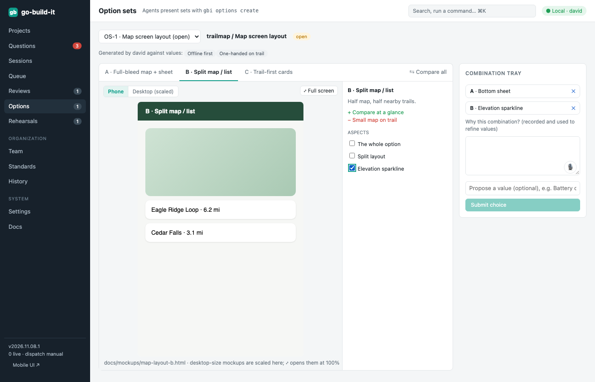

section: Using go-build-it
reqs: FR-120, FR-121, FR-122, FR-123, FR-124
# Option sets

For significant decisions, the Architect presents 2–3 alternatives. Each has a summary, pros and cons, and usually a mockup. You review one large preview at a time, compare them side by side, or open them full screen.

Tick aspects in any option; they collect in the **combination tray**. Say why: your reason is recorded and refines the project's values. Future option sets are generated against those values.

