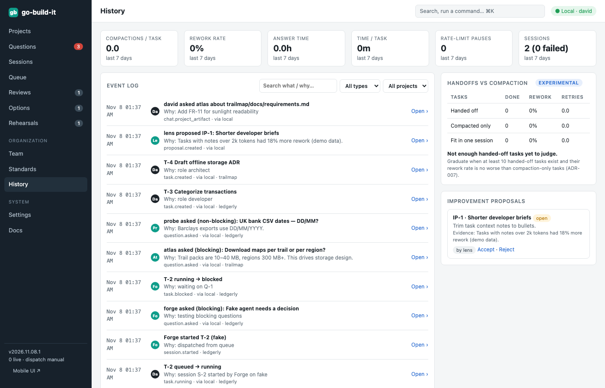
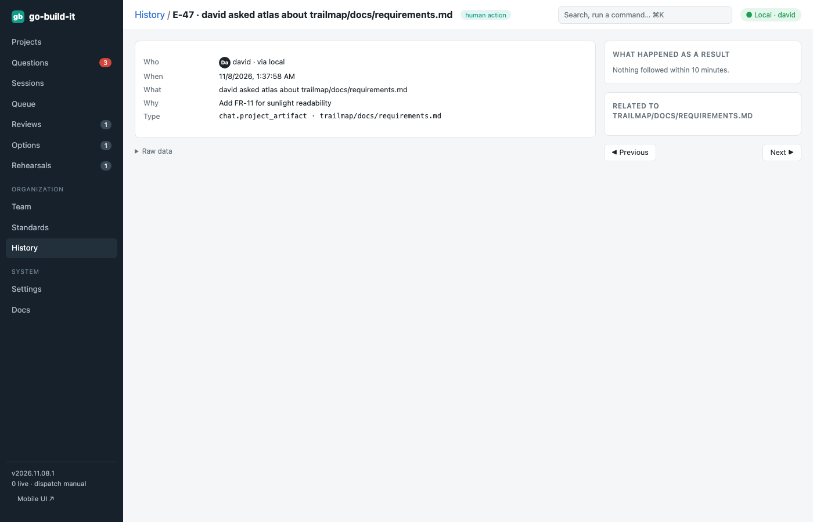

section: Using go-build-it
reqs: NFR-10, NFR-11, NFR-12, NFR-13, NFR-14
# History and insights

Every action is recorded: who did it (human or persona, and how they connected), when, and why. Search and filter the log. Every event opens a detail page for its kind, showing what was shown, what was decided, and what happened as a result.

Agents analyze the same data (`gbi history list --json`, `gbi metrics get --json`) and propose improvements (`gbi proposals create`). Accepting a proposal creates a task that goes through normal review.
