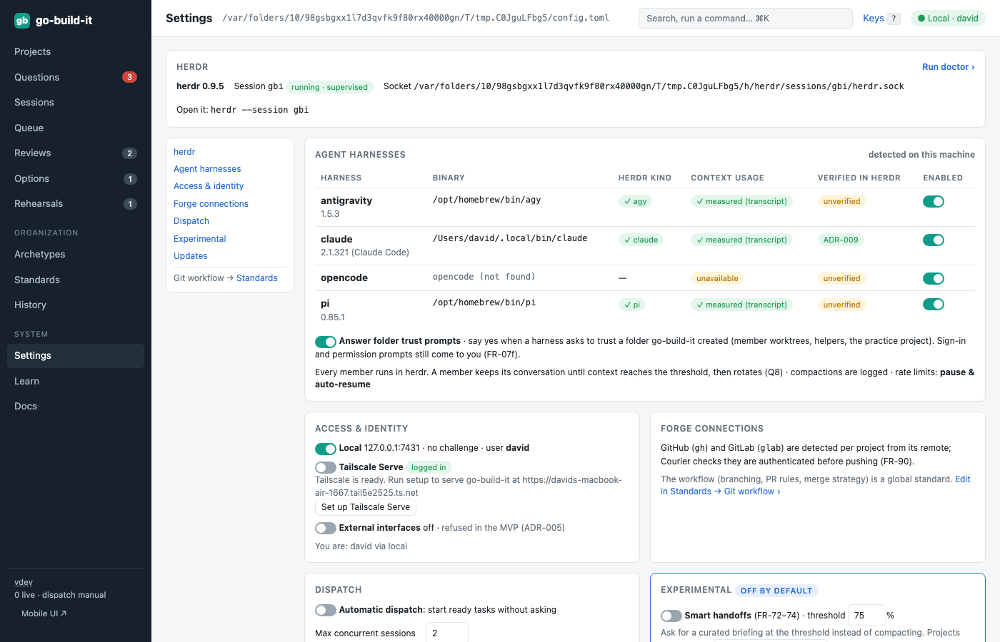
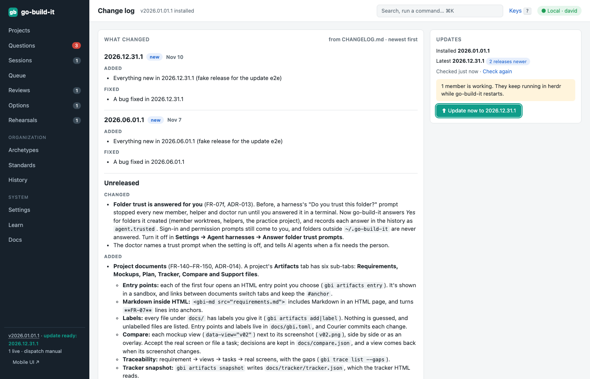
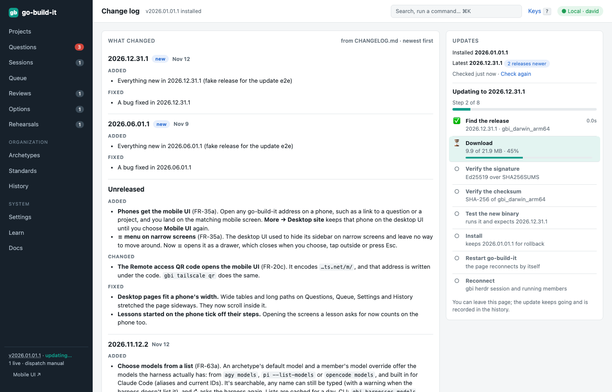
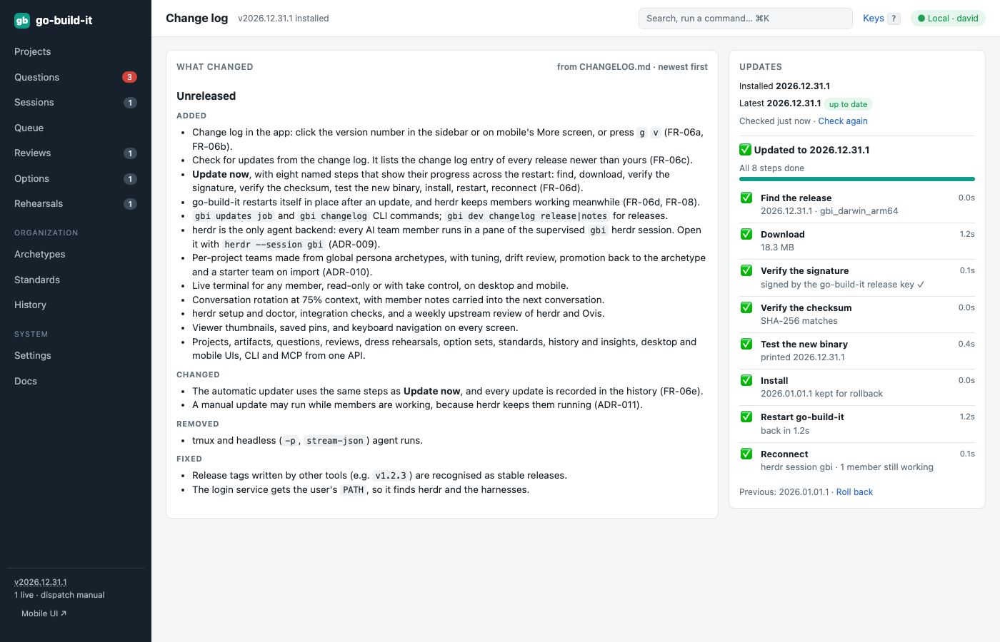

section: Using go-build-it
reqs: FR-05, FR-07f, FR-06, FR-06a, FR-06b, FR-06c, FR-06d, FR-06e, FR-07, FR-63, FR-90
# Settings and updates

Settings cover:
- **herdr:** the supervised `gbi` session, its version and socket; **herdr setup** runs the doctor (FR-07)
- **harnesses:** detection, enable or disable each one, its herdr agent kind, and whether its context usage is measured (from the transcript) or unavailable. **Answer folder trust prompts** (on by default) lets go-build-it say yes when a harness asks to trust one of go-build-it's own folders ([Sessions](sessions))
- **access:** Tailscale
- **forges:** GitHub and GitLab
- **dispatch**
- **experimental features**
- **updates**

The git workflow is a standard, not a setting.



## Change log and updates

Click the version number at the bottom of the sidebar, or press <kbd>g</kbd> <kbd>v</kbd>, to open the **change log**. On a phone, tap the version on **More**. The change log is the same `CHANGELOG.md` the releases are made from: newest first, with the installed version marked (a development build shows *Unreleased*).



The **Updates** panel checks for a newer release when the page opens, and again when you press **Check again**. It shows:
- your version and the latest release
- when the check ran
- the change log entry of every release newer than yours, at the top of the list, so you can read what an update brings first

The sidebar also shows *update ready* after a check finds one.

**Update now** runs the update as eight steps, and each one shows as it completes:

1. **Find the release** for your platform.
2. **Download** it, with size and percentage.
3. **Verify the signature:** `SHA256SUMS` must be signed by the go-build-it release key (Ed25519).
4. **Verify the checksum:** the download must match `SHA256SUMS`.
5. **Test the new binary:** it is run once and must report the expected version.
6. **Install:** your current version is kept for rollback.
7. **Restart go-build-it:** it restarts in place. The page waits for it to come back.
8. **Reconnect:** to the `gbi` herdr session and the members' running work.



Members keep working during an update, because herdr owns them. The restarted go-build-it finishes the last two steps, and the page then reloads into the new version.



If a step before **Install** fails (for example, offline, a bad signature, or a checksum mismatch), nothing has changed, and **Try again** starts over. If something fails after **Install**, **Roll back** restores the previous version the same way, and **Roll back** next to *Previous* is always available.

**Automatic updates** (Settings → Updates → auto-install) check every six hours. They use the same steps and show in the same place, but wait until no member is working. Every update, failure and rollback is recorded in the history (`update.*` events).

From the CLI:

```
gbi changelog                 # the change log
gbi updates check             # latest release and every newer release's notes
gbi updates install           # start the update; then:
gbi updates job               # the running or last update, with its steps
gbi updates rollback          # restore the previous version and restart
```

Releases come from GitHub Releases, signed with Ed25519 (ADR-004, ADR-011).
