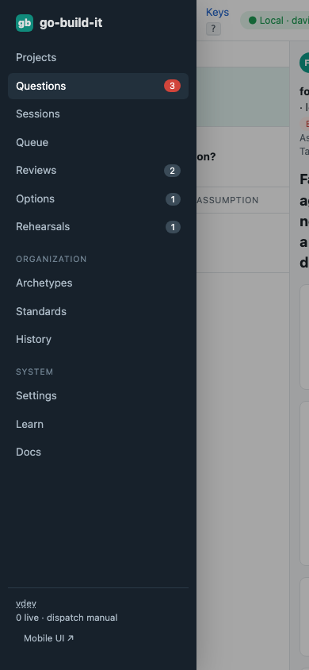
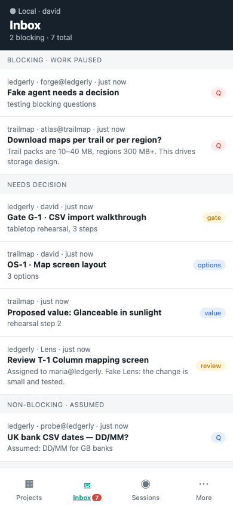

section: Using go-build-it
reqs: FR-35, FR-35a, FR-36
# Mobile

Open go-build-it on your phone, over your tailnet. The quickest way is to scan the QR code in **Settings → Remote access**. A phone always gets the mobile UI at `/m/`: open any go-build-it link on a phone, such as a question someone sent you, and you land on the matching mobile screen. The mobile UI puts the common tasks first:
- the inbox of everything waiting on you
- answering questions
- reviews
- rehearsal steps
- option sets
- team members at work: the live herdr terminal of any member, with take control and a key bar (Esc, Tab, Ctrl-C, arrows, Enter)
- members waiting for you, in the inbox

Add it to your home screen to install it.

## The desktop site on a phone

Need a page the phone screens don't have, such as Archetypes or the task queue? Choose **More → Desktop site**. That phone then stays on the desktop UI until you choose **Mobile UI** again. The desktop navigation is behind **☰** at the top left, and **Mobile UI ↗** is at the bottom of that menu. The links under **More → On the desktop site** do the same for one page.

A narrow browser window on a computer keeps the desktop UI too, with the same ☰ menu.

## Learn on the phone

**More → Learn** lists the lessons and your progress, the same as on desktop. Open one to see its steps with Pro tips. **Go there** opens the phone screen a step is about, and steps tick themselves off as you work. Lessons about desktop-only areas say so.
