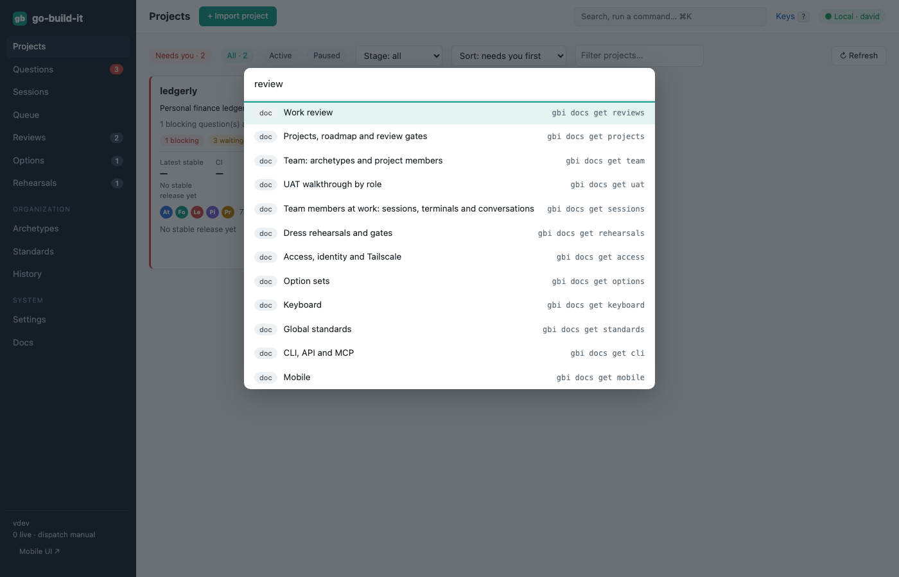

section: Reference
reqs: FR-30, FR-31, FR-32, FR-33
# CLI, API and MCP

Every UI action is an API call with a matching CLI command: `gbi help` lists them, and `gbi help <group>` shows flags. Add `--json` for machine-readable output.

```
gbi projects list
gbi tasks add --project ledgerly --title "Remember mapping" --reqs FR-23
gbi questions ask --task T-12 --blocking --title "Per trail or per region?"
gbi reviews verdict R-3 --verdict approve
gbi members list ledgerly
gbi members restart forge@ledgerly --fresh
gbi herdr doctor
```

**Identity.** When an agent runs `gbi` inside its own worktree (`…/worktrees/<project>/members/<name>`), the command is attributed to that member automatically. Elsewhere, set `GBI_PERSONA`.

- **OpenAPI:** `GET /api/openapi.json`.
- **External agents:** run `gbi mcp`, an MCP server over stdio with one tool per API operation.
- **Command palette:** ⌘K searches everything and shows the CLI equivalent of each command.


