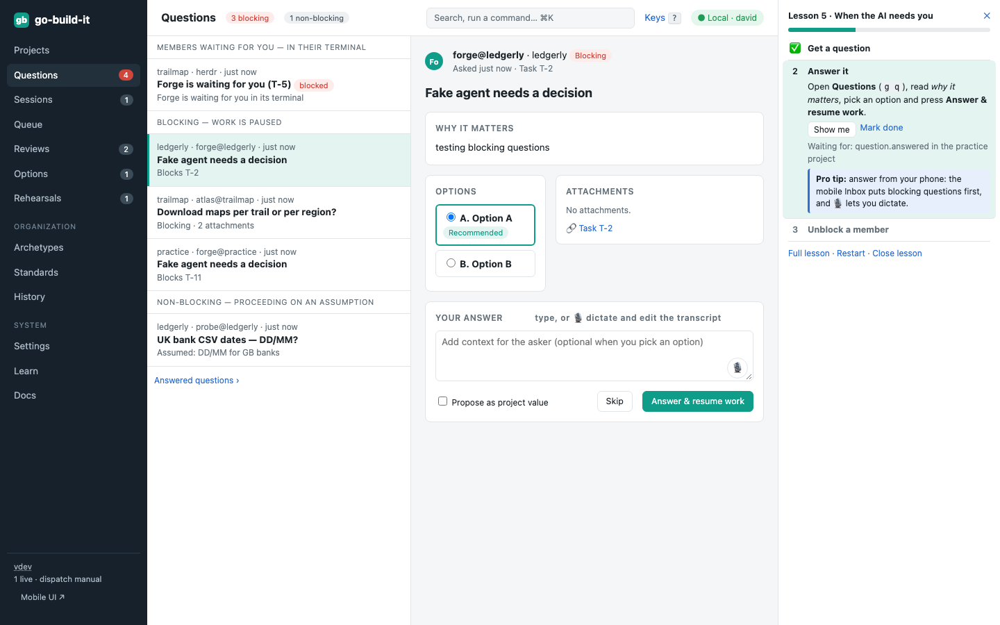
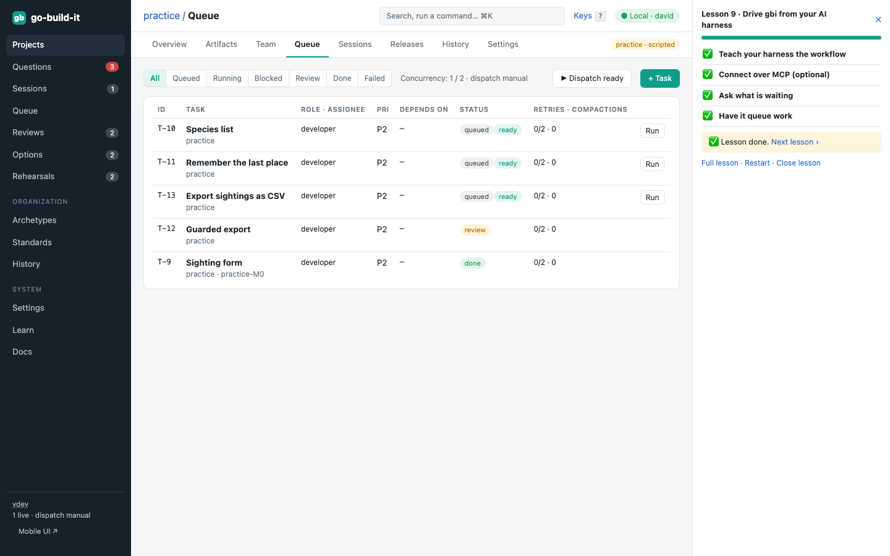

section: Using go-build-it
reqs: FR-30, FR-32, FR-33, FR-137, FR-139
# Drive gbi from your AI harness

Every action in go-build-it's UI is also a `gbi` command and an MCP tool. That means the AI harness you already use (Claude Code, Antigravity, Pi, OpenCode) can drive go-build-it for you. Ask it in plain words; it runs the commands, and the result shows up in gbi like anything else, recorded in the history.

This page is the cookbook: how to connect, then examples. Each example shows what you ask, what the harness runs, and what you then see.

## Connect

There are two ways. Use either, or both.

| | CLI | MCP |
|---|---|---|
| What it is | the harness runs `gbi … --json` in its shell | `gbi mcp` is an MCP server over stdio, with one tool per operation |
| Works with | any harness that can run commands | harnesses that support MCP servers |
| Set up | nothing: `gbi` is on your PATH | Claude Code: `claude mcp add gbi -- gbi mcp` |
| Best for | everything, and scripts | typed tools in Claude Code |

**Teach your harness the workflow.** `gbi agent guide` prints a guide written for AI agents: the commands, how gbi works, and the rules. The most important rule is *ask before starting paid work*. For Claude Code, save it as a skill:

```
mkdir -p ~/.claude/skills/gbi && gbi agent guide > ~/.claude/skills/gbi/SKILL.md
```

**Other harnesses:**
- **Antigravity, Pi, OpenCode:** paste the guide into the harness's instructions file, or into an `AGENTS.md` in the folder you start it from. All three can run shell commands, so the CLI works as-is.
- **MCP:** if your harness supports MCP servers, register `gbi mcp` as a stdio server the way that harness documents it.

> **Pro tip:** start your harness in a folder that isn't one of gbi's project worktrees when you use it to drive gbi, so it doesn't mistake gbi's tasks for its own.

## Examples

All of these work against the practice project, so you can try them without spending anything. Each `$ gbi` line here is run by go-build-it's tests against a demo, so it stays correct.

### "What's waiting on me?"

```
you › what's waiting on me in gbi?
● Bash  gbi inbox list --json
claude › Two things need you:
  1. Q-3 (practice, blocking): "Fake agent needs a decision". Option A is recommended.
  2. Review R-2 (practice): Sighting form. Lens recommends approving.
  Answer Q-3 with A?
```

The command:

```
$ gbi inbox list --json
```

What you see: the same items, in the same order, in **Questions** and **Reviews**.



### "Add a task for the developer: export sightings as CSV"

```
you › add a task to the practice project for the developer: export sightings as CSV
● Bash  gbi tasks add --project practice --title "Export sightings as CSV" --role developer --description "One row per sighting: species, place, time, note."
claude › Queued T-7 "Export sightings as CSV" for the developer role. Shall I start it? It runs on the scripted harness, so it costs nothing.
```

```
$ gbi tasks add --project practice --title "Export sightings as CSV" --role developer --description "One row per sighting: species, place, time, note."
```

What you see: the task in the practice queue, and in the history as *task.created* by you, through the CLI.



### "Answer Q-3 with A" and "approve R-2"

Decisions are yours; the harness carries them out:

```
gbi questions answer Q-3 --choice A
gbi reviews verdict R-2 --verdict approve --comment "Looks right on the phone too."
```

The answer resumes the paused task right away. The review approval lets Courier merge the work.

### "Who is blocked?"

```
$ gbi sessions list --live --json
```

A session whose `status` is `blocked` is waiting in its terminal, for example at a permission prompt. Your harness can't answer that for you. Open it in **Sessions → Open terminal** and take control.

### "What happened today?"

```
$ gbi history list --project practice --limit 5 --json
```

### "Is gbi working?"

```
$ gbi doctor --tier static --json
```

The harness reads `exit`:
- `0`: all good.
- `1`: it may run `gbi doctor --fix` itself.
- `2`: it gives you each fix whose `kind` is `human`, word for word.

## Good habits

- **Let it read; have it ask before it runs.** Listing, searching and reading history are free. Running tasks and dispatching spend your subscription.
- **Ask for IDs back** (T-7, Q-3, R-2). They match what you see in the UI and in the history.
- **Use `--json`.** The output is exactly what the UI shows, so the harness's summary matches your screen.

> **Pro tip:** `gbi events watch --project practice` streams events live. A harness can follow it to tell you the moment a member blocks.
